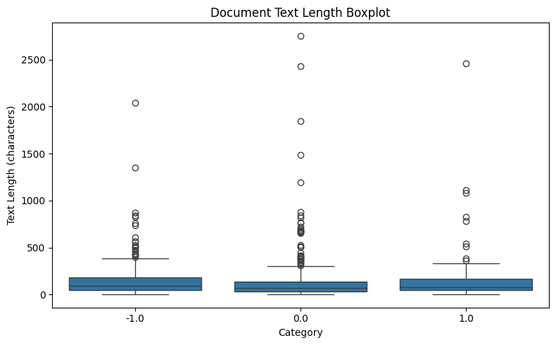
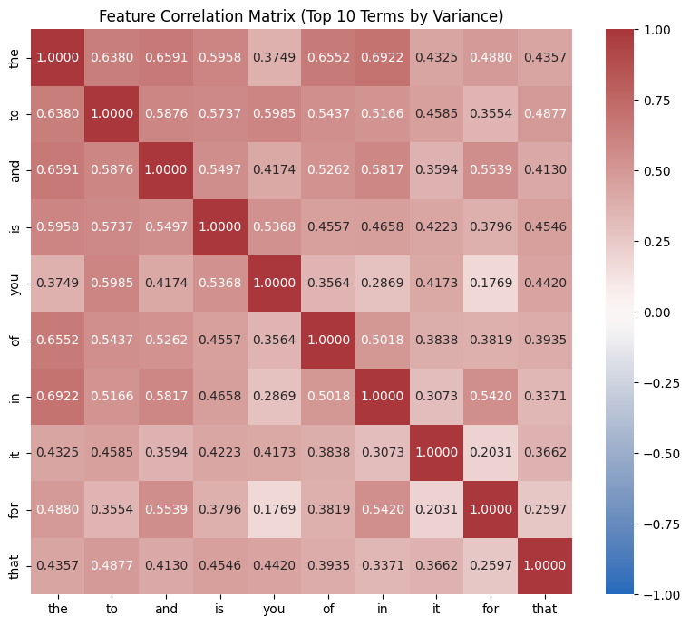
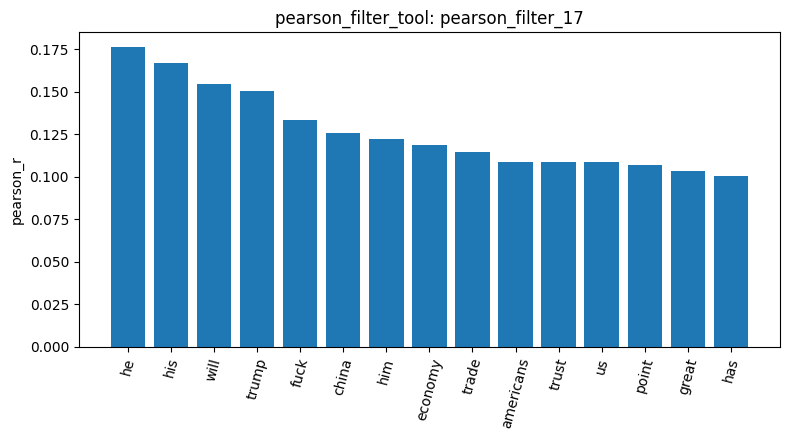
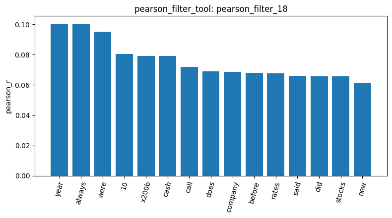
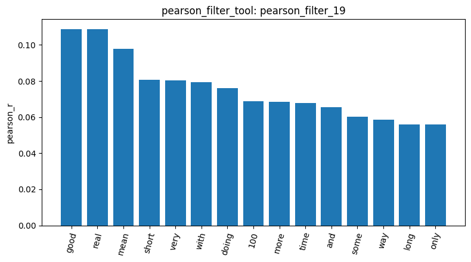
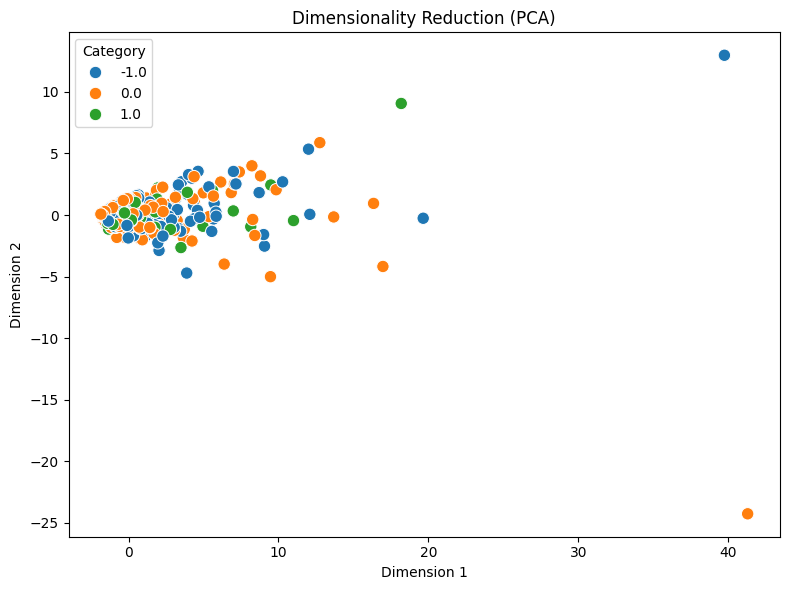
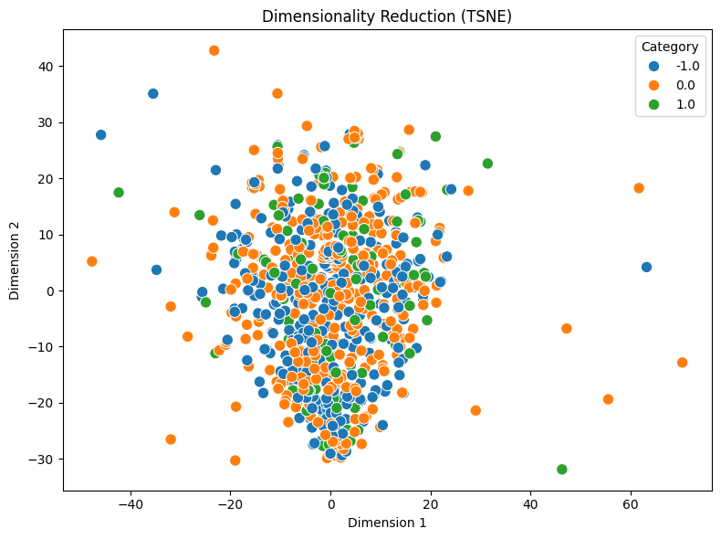
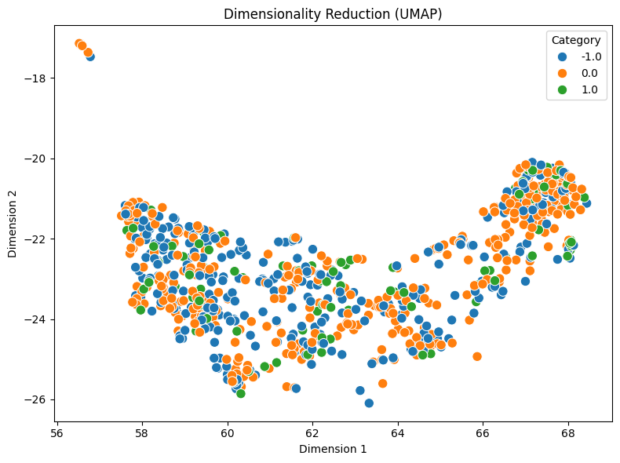

# Report - Juan Diego Niebles Navas - Homework

First, with the agent we load the reddit stock sentiment dataset, which had 847 documents with the sentiments categories of "-1.0", "0.0", and "1.0". However, when ussing check_missing_tool and check_duplicates_tool, we could identify there were no missing values, but there were 23 duplicate records that were removed from the dataset. With this cleaning we have that the cleaned dataset contained a total of 813 remaining documents, distributed across 391 "Neutral" (0.0), 315 "Negative" (-1.0), and 107 "Positive" (1.0). After this, we run a descriptive analysis, in which we found the overall mean document length was of 148.3 tokens. And, across categories: positive sentiment posts had the highest mean length 166.0 tokens, compared to neutral 0.0, 139.1 tokens, and negative 153.7 tokens posts. This information in more clear on the next visualization:

After that, toguether we develop the document term matrix (DTM), in which we discuss and decided to use ngram_range = [1,1], max features = 1000, and min_df = 0.01. This make a dtm with 813 documents, 294 vocabulary terms and a sparsity of 96.04%. Then, we run a term frequency ranking and a visualization of the heatmap, that you can see below, which show the predominance of stop-words.

Then, we decided to use an aggressive threshold of 0.1 to remove these stopwords, we used this threshold not only in variance filter tool, but also in pearson and spearman tool to compare both tools. The tool that selected more accurate terms was Pearson, which words selection can be seen on the plots below. Even though it is hard to tell if those words are actually meaningful for the category because some of them lack of contexts, there are some words that help to identify both extremes such as curse words or positive words such as "good".

Negative words

Neutral words

Positive words

After this, talking with the agent we decided to run topk= 10 with tf-idf for filtering clusters without losing important information. Here we could find good insights of data, such as some words that are perceived as negative such as "trump" (support = 42), "just" (support = 42), "china" (support = 33), and "market" (support = 23). For neutral posts, these were dominated by general commentary terms like "like" (support = 36) and "market" (support = 28). And for positive sentiment posts  it centered on performance indicators, including "good" (support = 12), "doing" (support = 9), and "economy" (support = 6). 

Then we did a dimensionality reduction. This dimensionality reduction was for understanding better how the data was behaving and if it was possible to separate it into clusters. For this step we decided to do the three visualizations PCA, TSNE, and UMAP. None of these representations help us to identify clear difference on the clusters but we can understand some things. First, we see little green points that correspond to the category "1.0", this might be because is the category with the lower amount of data. The other aspect we can uderstand is  about the distribution of the words, which is shown that there are mainly similar between clusters making the clusters have a heavy overlap. Finally, we run some cosine similarity, which even on same cluster show really low values (0.0993 between Index 0 and 3) something that can mean that the data is really sparse.

PCA

TSNE

UMAP

